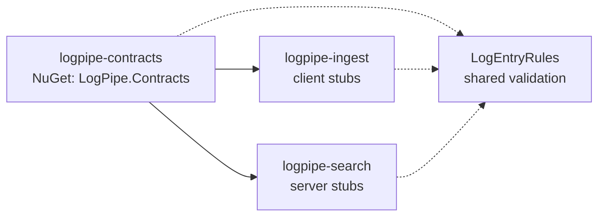

# logpipe-contracts

[](https://github.com/TiagoR85/logpipe-contracts/actions/workflows/ci.yml)
[](LICENSE)

Versioned gRPC contract for the logpipe log pipeline. This package is the single source of truth for the wire format between `logpipe-ingest` and `logpipe-search`, plus the validation rules both services share.



## What's in the package

- **gRPC service** `logpipe.v1.LogIngest` with one RPC: `StreamLogs (stream LogEntry) returns (StreamAck)` — client-streamed batch ingest, one call = one batch.
- **Messages** `LogEntry` (id, timestamp, level, service, message, trace_id, span_id, attributes map) and `StreamAck` (accepted, rejected, error).
- **C# stubs for both sides** (`LogIngestClient` + `LogIngestBase`) — see [ADR-0002](docs/adr/ADR-0002-grpc-services-both.md).
- **`LogEntryRules`** — shared validation (levels set, length limits, W3C trace/span id hex checks, `MaxEntriesPerBatch = 1000`) so the REST ingress and the gRPC ingress cannot drift.

## Consuming the contract

Three supported paths (no private NuGet feed — see [ADR-0003](docs/adr/ADR-0003-contract-release-protocol.md)):

1. **Local / CI:** pack from a tagged clone into a local feed:

   ```powershell
   pwsh scripts/fetch-contracts.ps1 -Ref v1.0.0   # lives in the consuming repo
   ```

   The consuming repo's `nuget.config` adds the relative `./packages` source; pin the version in `Directory.Packages.props`:

   ```xml
   <PackageVersion Include="LogPipe.Contracts" Version="1.0.0" />
   ```

2. **Docker:** fetch and pack in the builder stage:

   ```dockerfile
   ADD https://github.com/TiagoR85/logpipe-contracts.git#v1.0.0 /tmp/contracts
   RUN dotnet pack /tmp/contracts/src/LogPipe.Contracts/LogPipe.Contracts.csproj -c Release -o /tmp/contract-packages
   ```

3. **Release asset:** download `LogPipe.Contracts.<version>.nupkg` from the GitHub Release and add it to a local feed.

## Releasing a new contract version

1. Bump `<Version>` in `src/LogPipe.Contracts/LogPipe.Contracts.csproj` (SemVer: breaking wire change = major).
2. Update/extend the tests, run them green.
3. Tag `vX.Y.Z` and push the tag — CI packs and attaches the `.nupkg` to the GitHub Release.
4. Consumers bump their `PackageVersion` pin and their `fetch-contracts.ps1 -Ref` / Docker `#ref`.

## Running tests

```powershell
dotnet test tests/LogPipe.Contracts.Tests/LogPipe.Contracts.Tests.csproj -c Release
```

Coverage gate: 80% line (enforced in CI; generated protobuf stubs in `LogPipe.Contracts.V1` are excluded from the denominator — only hand-written code is measured).

## Decisions

- [ADR-0001](docs/adr/ADR-0001-proto-as-single-source.md) — the .proto lives here and ships as a versioned NuGet package
- [ADR-0002](docs/adr/ADR-0002-grpc-services-both.md) — one package with client and server stubs
- [ADR-0003](docs/adr/ADR-0003-contract-release-protocol.md) — releases are GitHub tags with the .nupkg attached

## Roadmap

- Patch/minor contract versions as the logpipe family grows (jobforge in F3 may define its own contract repo following this pattern).
- This repo ships no runtime of its own — the package is the product.

## About this repository

This repository is part of a personal study project (the "github-portfolio-dotnet" portfolio). It was built with heavy use of AI-assisted development tools, but it is held to production standards on purpose: automated tests with a coverage gate, CI on every push, versioned contracts, and honest documentation of trade-offs. It is not affiliated with any employer or client.

## License

MIT — see [LICENSE](LICENSE).
